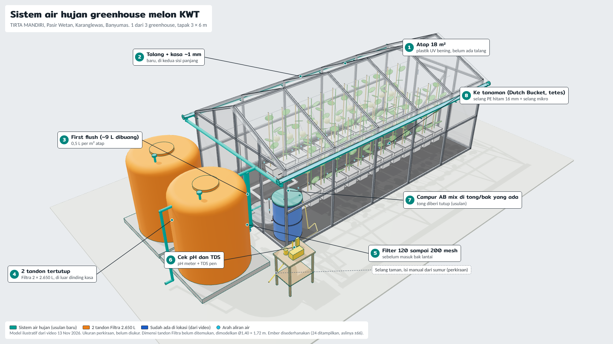

# Prototype 3D TIRTA MANDIRI

Prototype 3D sistem air hujan untuk greenhouse melon KWT Sukadamai, Desa Pasir Wetan (Karanglewas, Banyumas). Aku bikin ini buat proposal ACC #NextGreen Leaders Challenge 2026.

Idenya: atap greenhouse (3 x 6 m) dipakai buat nampung air hujan, airnya disaring, disimpan di 2 tandon, lalu jadi cadangan atau campuran air baku nutrisi pas kemarau. Air sumur tetap dipakai.

**Viewer online:** https://milhan-z.github.io/nextgreen-prototype-3d/



## Unduh
| File | Isi |
| --- | --- |
| [Viewer 3D](https://milhan-z.github.io/nextgreen-prototype-3d/) (`dist/index.html`) | Viewer interaktif, jalan offline (Three.js, model, dan font sudah di dalam file) |
| [`gambar-teknik-A3.pdf`](https://milhan-z.github.io/nextgreen-prototype-3d/gambar-teknik-A3.pdf) | Lembar gambar teknik A3: tampak atas, samping, depan, isometri, daftar komponen, alur air |
| [`prototype.step`](https://milhan-z.github.io/nextgreen-prototype-3d/prototype.step) | CAD assembly berwarna (mm) |
| [`prototype.stl`](https://milhan-z.github.io/nextgreen-prototype-3d/prototype.stl) | Mesh gabungan (mm) |
| [`prototype.glb`](https://milhan-z.github.io/nextgreen-prototype-3d/prototype.glb) | Model 3D berwarna (meter, sumbu Y ke atas) |
| [`renders/`](renders/) | Render 1920 x 1080 berlabel dari tiap sudut pandang |

## Viewer
- **Sudut pandang:** Keseluruhan, Tandon, Stasiun air, Samping, Dalam, Sudut tong.
- **Simulasi hujan:** Gerimis (5 mm/jam), Sedang (20), Lebat (50). Air masuk = hujan (mm) x 18 m² x 0,8. 9 L pertama dibuang lewat first flush, sisanya mengisi 2 tandon (kapasitas nominal 5.300 L). Kalau penuh, air keluar lewat pelimpah.
- **Pakai air nutrisi:** mengurangi 64,4 L per hari (hitungan tim) supaya kelihatan cadangannya cukup berapa hari.
- **Lapisan:** label, aliran air, atap/kasa, tanaman.

Simulasinya kasar, buat ilustrasi, bukan hasil ukur.

## Sistem yang diusulkan (warna toska di model)
1. Atap 18 m² (sudah ada)
2. Talang PVC + kasa kira kira 1 mm di kedua sisi panjang (baru)
3. First flush kira kira 9 L dibuang per greenhouse (0,5 L per m² x 18 m², acuan UNDP 2016)
4. Dua tandon tertutup Filtra TB 2500 (2 × 2.650 L), disambung pipa bawah, dengan pelimpah, lubang angin berkasa, kran di atas dasar (baru)
5. Filter 120 sampai 200 mesh sebelum masuk bak (baru)
6. Cek pH dan TDS (baru)
7. Campur AB mix di tong/bak yang sudah ada
8. Ke tanaman lewat pompa dan tetes yang sudah ada

Harga nggak ada di sini. Rincian biaya ada di lembar RAB terpisah.

## Asumsi & perkiraan
Semua angka ini perkiraan dari foto/video, belum diukur di lapangan:
- Tapak 3 x 6 m dan atap 18 m² dari data tim.
- Tinggi tepi kira kira 1,9 m, bubungan kira kira 2,6 m, jarak tiang kira kira 1,2 m, profil rangka 40 mm.
- Tong kira kira 200 L (Ø0,58 x 0,88 m). Bak lantai Ø0,80 m, dalam 0,60 m. Ukuran pompa celup.
- Pipa balik PVC kira kira 2 inch, selang PE 16 mm, ukuran pipa isi PVC dari atas dan dari mana asalnya.
- Dimensi tandon Filtra 2.650 L belum ditemukan, dimodelkan Ø1,40 x 1,72 m (perkiraan). Dua tandon berjajar di luar dinding kasa sisi timur.
- Diameter talang (kira kira 4 inch), pipa turun (kira kira 2,5 inch), first flush pipa Ø110 sepanjang 1,20 m (kira kira 9 L), letak filter dan meja cek air.
- Arah utara belum dicek. Jalur persis kabel pompa dan selang taman juga belum dicek.
- Ember ditampilkan 24 biar gambar jelas, aslinya sekitar 60 sampai 66 tanaman.
- Model ini ilustrasi buat proposal, bukan gambar kerja konstruksi. Satu dari tiga greenhouse.

Kondisi lapangan yang jadi dasar model ada di [`docs/catatan-lapangan.md`](docs/catatan-lapangan.md).

## Struktur repo
```
dist/        viewer (index.html) dan model hasil ekspor (STEP, STL, GLB)
drawings/    gambar teknik A3 (PDF, PNG)
renders/     render PNG berlabel
src/         model parametrik CadQuery (semua ukuran di dict P di model.py), ekspor, proyeksi 2D, lembar A3
web/         sumber viewer Three.js dan skrip render
docs/        arah desain viewer, catatan lapangan, riwayat perubahan, audit antislop
```

## Bangun ulang
```
python3 -m venv .venv && . .venv/bin/activate && pip install -r requirements.txt
npm install
python src/export.py      # dist/prototype.step, .stl, .glb dari src/model.py
python src/drawing.py     # proyeksi HLR buat gambar 2D
npm run build             # dist/index.html
npm run render            # renders/*.png dan src/iso-sheet.png (butuh Chrome)
cp src/iso-sheet.png renders/render-5-iso-nomor.png
python src/sheet.py       # drawings/gambar-teknik-A3.pdf dan .png
```

Setiap push ke `main`, GitHub Actions menyalin isi `dist/`, `renders/`, dan `drawings/` ke GitHub Pages.
